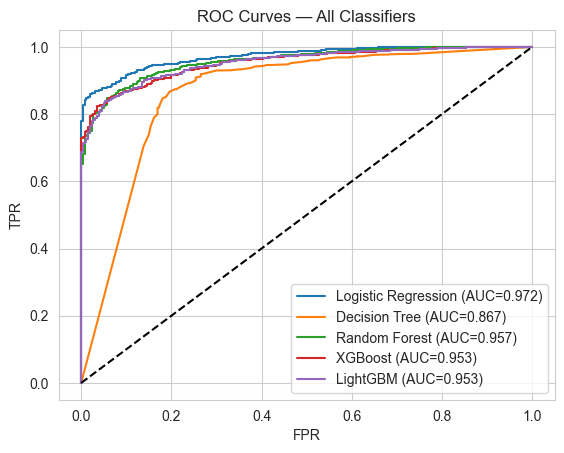
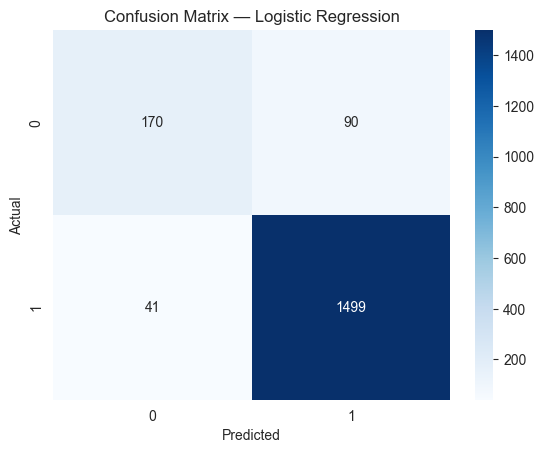
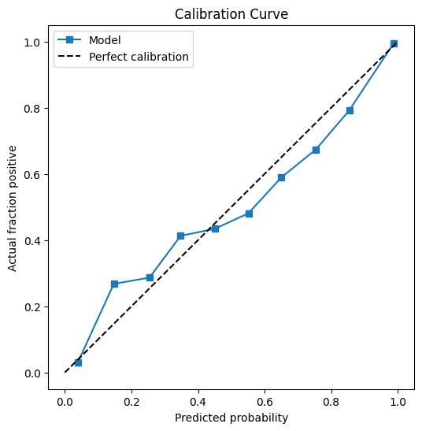
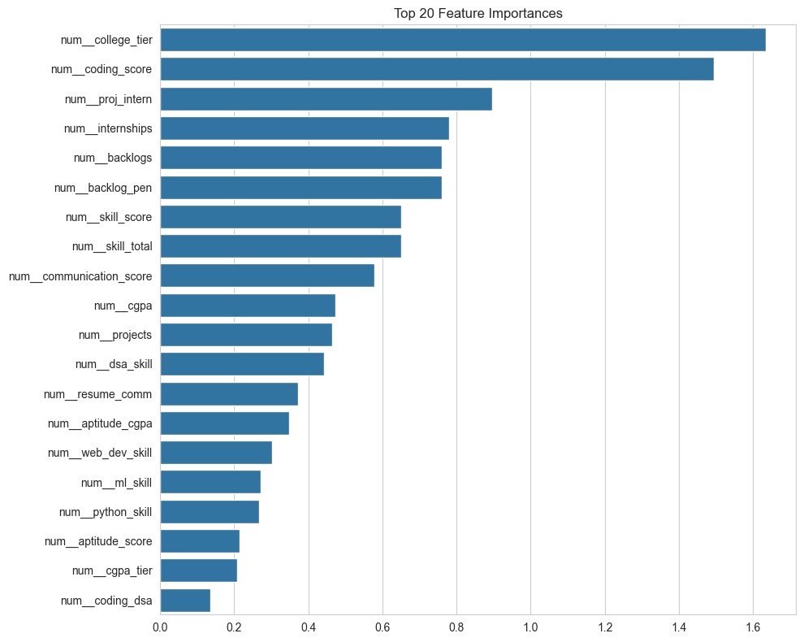
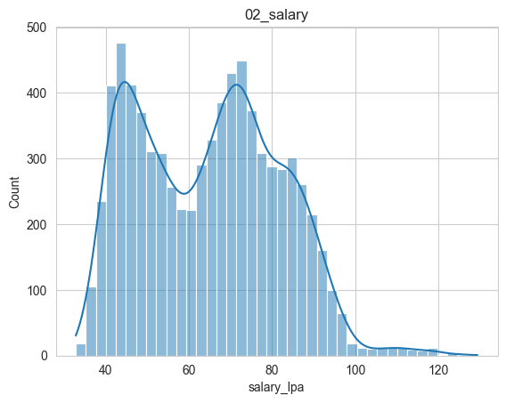

<div align="center">

# 🎓 Student Placement & Salary Predictor

### An end-to-end Machine Learning project that predicts student placement outcomes and expected salary using academic, technical, and profile features.

[](https://www.python.org/)
[](https://streamlit.io/)
[](https://scikit-learn.org/)
[](https://xgboost.readthedocs.io/)
[](https://lightgbm.readthedocs.io/)
[](https://opensource.org/licenses/MIT)

[🌐 Live Demo]([https://your-app.streamlit.app](https://student-placement-salary-predictor-89.streamlit.app/)) · [📊 Dataset](student_placement_salary_elite_v2.csv) · [🐛 Report Bug](https://github.com/AKASHPATEL-89/Student-Placement-Salary-Predictor/issues)

</div>

---

## 📖 Table of Contents

- [Overview](#-overview)
- [Live Demo]([#-live-demo](https://student-placement-salary-predictor-89.streamlit.app/))
- [Features](#-features)
- [Dataset](#-dataset)
- [Methodology](#-methodology)
- [Model Performance](#-model-performance)
- [Key Visualizations](#-key-visualizations)
- [Installation](#-installation)
- [Project Structure](#-project-structure)
- [Tech Stack](#-tech-stack)
- [Screenshots](#-screenshots)
- [Future Improvements](#-future-improvements)
- [Author](#-author)
- [License](#-license)

---

## 🎯 Overview

This project predicts **two things** for a student:

1. **Will they be placed?** — Binary classification (Yes / No)
2. **If placed, what salary?** — Regression (in LPA)

Built as a **complete ML pipeline** — from raw data to a deployed web application.

The pipeline covers:
- 🔍 **EDA** — Missing values, distributions, correlations
- 🛠️ **Feature Engineering** — 7 domain-driven features
- 🚨 **Leak Prevention** — Removed post-placement signals
- 🤖 **Model Training** — 5 classifiers + 5 regressors compared
- 📊 **Evaluation** — ROC, confusion matrix, calibration curves
- 🚀 **Deployment** — Interactive Streamlit app

---

## 🌐 Live Demo

🔗 **[Try the app live →](https://your-app.streamlit.app)**

> Enter any student profile and get instant placement prediction with a probability gauge, expected salary, and personalized improvement tips.

---

## ✨ Features

### 🎨 Interactive Web App
- **Profile Builder** — Sidebar inputs with human-readable 0/1 labels
- **Probability Gauge** — Animated Plotly indicator with color zones
- **Radar Chart** — Compare against dataset median
- **8 Random Themes** — Animated gradient backgrounds with Pexels images
- **Skill Badges** — Live-updating visual skill level bar

### 🧠 Smart Outputs
- **Placement verdict** — ✅ Yes / ❌ No with confidence
- **Probability score** — Calibrated, not saturated
- **Expected salary** — Regression-based LPA prediction
- **Personalized tips** — Actionable improvement plan for weak profiles
- **Company recommendations** — Top Tech / MNC / Startup / Entry Level

### 📊 Analytics
- **Prediction History** — Session-wide log with stats
- **Engineered Features Panel** — See what the model sees
- **What-If Simulator** — Explore how changes affect outcomes
- **Batch Prediction** — Upload CSV, get predictions for thousands
- **Multi-Page App** — Insights and About pages

---

## 📊 Dataset

| Attribute | Details |
|---|---|
| **Size** | 9,000 students |
| **Features** | 20 (raw) + 7 (engineered) = 27 |
| **Target (Classification)** | `placed` (binary: 0 or 1) |
| **Target (Regression)** | `salary_lpa` (continuous) |
| **Placement Rate** | 85.6% placed / 14.4% not placed |
| **Avg Salary (placed)** | ₹64.75 LPA |

### Feature Categories

| Category | Features |
|---|---|
| 🎓 Academic | `cgpa`, `branch`, `college_tier`, `backlogs` |
| 💻 Technical Skills | `python_skill`, `dsa_skill`, `ml_skill`, `web_dev_skill` |
| 📊 Performance | `coding_score`, `communication_score`, `aptitude_score` |
| 🚀 Experience | `internships`, `projects` |
| 📄 Profile | `resume_score`, `skill_score` |

### Engineered Features (Custom)

| Feature | Formula | Purpose |
|---|---|---|
| `skill_total` | Sum of 4 skill flags | Overall skill breadth |
| `coding_dsa` | `coding_score × dsa_skill` | Coding proficiency signal |
| `cgpa_tier` | `cgpa / college_tier` | Normalized academic quality |
| `proj_intern` | `projects + 2×internships` | Weighted experience |
| `resume_comm` | `resume_score × communication_score` | Profile strength |
| `backlog_pen` | `-backlogs` | Negative indicator |
| `aptitude_cgpa` | `aptitude × cgpa / 10` | Combined cognitive score |

---

## 🔬 Methodology

### 1️⃣ Exploratory Data Analysis
- Missing values (1,298 in `company_type` & `job_role`)
- Target distribution analysis
- Correlation heatmaps
- Salary distribution by branch/company/tier

### 2️⃣ Leak Prevention ⚠️
**Critical fix:** Initially, all 5 models achieved **100% accuracy** — a clear sign of **data leakage**.

**Root cause:** `company_type` and `job_role` were `NaN` **only** for non-placed students. Filling them with `"None"` created a trivial rule:
> "If company_type != None → placed = 1"

**Fix:** Dropped `company_type`, `job_role`, and `salary_lpa` from classifier features. After the fix, accuracy dropped to a **realistic 92.7%**.

### 3️⃣ Model Training

Trained **5 classifiers** and **5 regressors** with stratified 80/20 split:

**Classification:**
1. Logistic Regression
2. Decision Tree
3. Random Forest
4. XGBoost
5. LightGBM

**Regression:**
1. Linear Regression
2. Ridge
3. Decision Tree
4. Random Forest
5. XGBoost

### 4️⃣ Probability Calibration
Applied **isotonic calibration** (`CalibratedClassifierCV`) to prevent overconfident 0%/100% predictions. Calibration curve verified against the diagonal.

---

## 🏆 Model Performance

### Classification Results

| Model | Accuracy | F1 Score | ROC-AUC |
|---|---|---|---|
| **Logistic Regression** ⭐ | **0.9272** | **0.9581** | **0.9717** |
| LightGBM | 0.9144 | 0.9509 | 0.9530 |
| XGBoost | 0.9133 | 0.9504 | 0.9528 |
| Random Forest | 0.9089 | 0.9484 | 0.9575 |
| Decision Tree | 0.8933 | 0.9380 | 0.8673 |

### Regression Results

| Model | MAE | RMSE | R² |
|---|---|---|---|
| **Random Forest** ⭐ | **7.95** | **10.21** | **0.6241** |
| XGBoost | 8.39 | 10.75 | 0.5836 |
| Decision Tree | 8.38 | 10.83 | 0.5771 |
| Ridge | 10.07 | 12.47 | 0.4394 |
| Linear | 10.07 | 12.47 | 0.4394 |

### Model Choice Rationale
- **Classifier:** Logistic Regression — highest AUC, interpretable coefficients, fastest inference
- **Regressor:** Random Forest — best R², handles non-linearity, robust to outliers

---

## 📈 Key Visualizations

### ROC Curves — All Models



### Confusion Matrix



### Calibration Curve



### Feature Importance



### Salary Distribution



---

## 🚀 Installation

### Prerequisites
- Python 3.10+
- pip

### Step 1 — Clone

```bash
git clone https://github.com/AKASHPATEL-89/Student-Placement-Salary-Predictor.git
cd Student-Placement-Salary-Predictor
```

### Step 2 — Virtual Environment

```bash
# Windows
python -m venv venv
venv\Scripts\activate

# macOS/Linux
python3 -m venv venv
source venv/bin/activate
```

### Step 3 — Install Dependencies

```bash
pip install -r requirements.txt
```

### Step 4 — Train Models

```bash
python train_pipeline.py
```

This generates:
- 📁 `models/best_classifier.pkl`
- 📁 `models/best_regressor.pkl`
- 📁 `outputs/` (all plots and reports)

### Step 5 — Launch App

```bash
streamlit run app.py
```

Open http://localhost:8501 in your browser. 🎉

---

## 📁 Project Structure

```
Student-Placement-Salary-Predictor/
│
├── 📄 app.py                          # Main Streamlit app
├── 📄 train_pipeline.py               # End-to-end training pipeline
├── 📄 test_model.py                   # Model sanity checker
├── 📄 verify_calibration.py           # Calibration verification
├── 📄 requirements.txt                # Python dependencies
├── 📄 README.md                       # This file
├── 📄 .gitignore
├── 📄 student_placement_salary_elite_v2.csv
│
├── 📁 models/
│   ├── best_classifier.pkl            # Calibrated classifier
│   └── best_regressor.pkl             # Trained regressor
│
├── 📁 outputs/
│   ├── eda_report.txt
│   ├── 01_target.png
│   ├── 02_salary.png
│   ├── 03_cgpa_salary.png
│   ├── 04_salary_branch.png
│   ├── 05_corr.png
│   ├── 06_coding_salary.png
│   ├── 07_skills_salary.png
│   ├── 08_company_dist.png
│   ├── 09_model_comparison.png
│   ├── 10_roc_curves.png
│   ├── 11_cm.png
│   ├── 12_actual_vs_pred.png
│   ├── 13_residuals.png
│   ├── 14_cls_importance.png
│   ├── 15_calibration.png
│   ├── classification_comparison.csv
│   ├── regression_comparison.csv
│   └── final_summary.txt
│
└── 📁 pages/
    ├── 1_📊_Insights.py               # Dataset insights page
    └── 2_ℹ️_About.py                  # About page
```

---

## 🛠️ Tech Stack

| Layer | Tools |
|---|---|
| **Data** | pandas, numpy |
| **ML** | scikit-learn, XGBoost, LightGBM |
| **Visualization** | matplotlib, seaborn, plotly |
| **Deployment** | Streamlit, Streamlit Cloud |
| **Model Storage** | joblib |
| **Language** | Python 3.10 |

---

## 📸 Screenshots

### 🏠 Home Page

*Interactive prediction interface with animated backgrounds*

### 📊 Insights Page

*Dataset exploration with Plotly charts*

### 📁 Batch Prediction

*Upload CSV for bulk predictions*

---

## 🚀 Future Improvements

- [ ] **Hyperparameter tuning** with Optuna
- [ ] **SHAP explainability** — per-prediction feature attribution
- [ ] **Survival analysis** — time-to-placement prediction
- [ ] **Deep learning** — neural network comparison
- [ ] **Real-world data** — replace synthetic dataset
- [ ] **REST API** — FastAPI endpoint for programmatic access
- [ ] **Docker** — containerize the app
- [ ] **CI/CD** — GitHub Actions for automated testing
- [ ] **A/B testing** — compare model versions in production
- [ ] **Feedback loop** — log real outcomes to retrain models

---

## 👨‍💻 Author

**Akash Patel**

[](https://github.com/AKASHPATEL-89)
[](https://linkedin.com/in/your-profile)
[](mailto:akashpatel895345@gmail.com)

---

## 🙏 Acknowledgments

- **Dataset:** Synthetic student placement data (9,000 records)
- **Backgrounds:** [Pexels](https://pexels.com) — free stock photos
- **Icons & Badges:** [Shields.io](https://shields.io)
- **Inspiration:** Real-world campus placement analytics

---

## 📄 License

This project is licensed under the **MIT License** — see the [LICENSE](LICENSE) file for details.

```
MIT License · Copyright (c) 2025 Akash Patel
```

---

<div align="center">

### ⭐ If this project helped you, please give it a star!

**Made with ❤️ using Python, Scikit-learn, and Streamlit**

</div>
